# 1. Introduction

This project builds and deploys an **image classification application**, a handwritten-digit
recognizer, using standard MLOps tooling:

| Concern | Tool |
|------------------------|------------------------------------------|
| Data and model versioning | **DVC**, with **AWS S3** as remote storage |
| Pipeline definition | `dvc.yaml` (prepare → train → evaluate) |
| Continuous integration and delivery | **GitHub Actions** (`.github/workflows/ci-cd.yaml`) |
| Containerization | **Docker** (`Dockerfile`), image published to GitHub Container Registry |
| Hosting | **AWS EC2**, the container served on port 80 |

**Model.** A Support Vector Machine (RBF kernel, `C = 10`, `gamma = 0.001`) with calibrated
probabilities, trained on 1,797 grayscale 8×8 digit images (scikit-learn *digits* dataset,
exported as PNG files).

**Result.** **99.17 % accuracy** and 0.9917 macro-F1 on 360 held-out test images.

## 1.1 Architecture

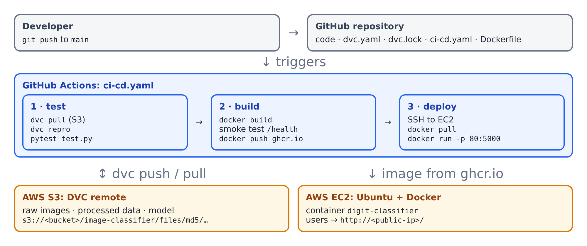

## 1.2 Repository layout

| File | Purpose |
|------------------------------|--------------------------------------------|
| `.github/workflows/ci-cd.yaml` | CI/CD workflow |
| `dvc.yaml`, `dvc.lock`, `params.yaml` | DVC pipeline, lock file, hyper-parameters |
| `data/raw.dvc` | DVC pointer for the 1,797-image dataset |
| `export_dataset.py` | exports the dataset as PNGs to `data/raw/<label>/` |
| `prepare.py`, `train.py`, `evaluate.py` | pipeline stages |
| `model.py` | preprocessing, model definition, prediction |
| `app.py`, `templates/index.html` | Flask web application |
| `test.py` | 12 automated tests |
| `Dockerfile`, `.dockerignore` | container image |
| `deploy/ec2-user-data.sh` | EC2 bootstrap (installs Docker) |
| `deploy/deploy-manual.sh` | manual deployment script |
| `requirements.txt`, `requirements-dev.txt` | runtime and development dependencies |

# 2. Step 1: Application

`model.py` holds the ML logic:

- `preprocess(image)` converts **any** uploaded image to the 64-value feature vector the
  model expects. It converts to grayscale, resizes to 8×8, inverts dark-on-light images
  (the training digits are light-on-dark) and scales the pixels to 0–16.
- `build_model()` creates the calibrated SVM. `predict()` returns `{"label", "confidence"}`.

`app.py` is a Flask application, served by **gunicorn** inside Docker:

| Method | Route | Purpose |
|------|----------|--------------------------------------------|
| GET | `/` | Web page: draw a digit on a canvas, or upload an image |
| GET | `/health` | Health check, used by Docker `HEALTHCHECK`, CI smoke test and deploy verification |
| POST | `/predict` | Form field `image` → JSON prediction; returns 400 for a missing or invalid file |

# 3. Step 2: DVC pipeline

## 3.1 Initialise DVC and version the raw images

```bash
dvc init
python export_dataset.py        # 1,797 PNGs -> data/raw/0 ... data/raw/9
dvc add data/raw                # creates data/raw.dvc; data/raw is git-ignored
```

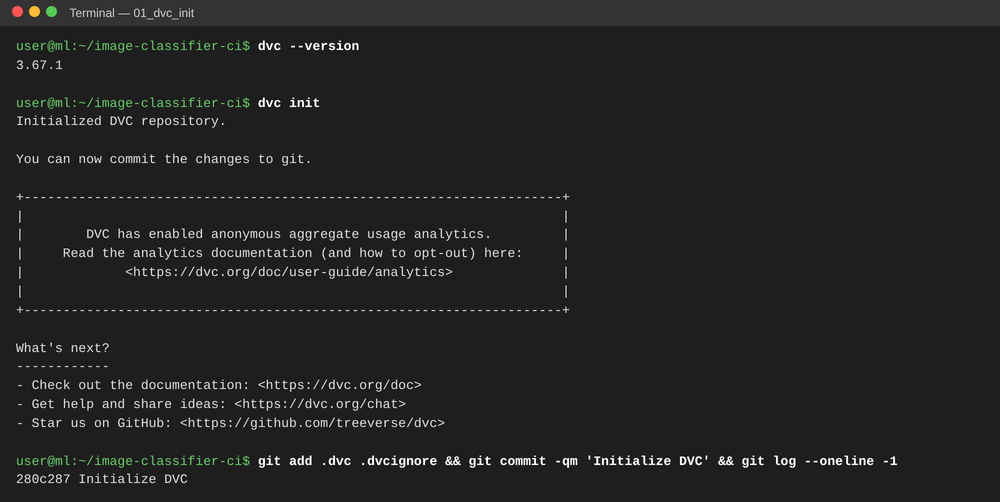


## 3.2 Pipeline definition (`dvc.yaml`)

```yaml
stages:
  prepare:
    cmd: python prepare.py
    deps: [prepare.py, model.py, data/raw]
    params: [prepare]
    outs: [data/processed]
  train:
    cmd: python train.py
    deps: [train.py, model.py, data/processed]
    params: [train]
    outs: [models/digit_classifier.joblib]
  evaluate:
    cmd: python evaluate.py
    deps: [evaluate.py, models/digit_classifier.joblib, data/processed]
    metrics:
      - metrics.json: {cache: false}
```

| Stage | Input | Output |
|--------|------------------------|------------------------------|
| prepare | `data/raw/*/*.png`, `params.prepare` | `data/processed/{train,test}.npz` (stratified 80/20 split) |
| train | training split, `params.train` | `models/digit_classifier.joblib` |
| evaluate | model and test split | `metrics.json` |

`dvc repro` runs only the stages whose dependencies changed. `dvc.lock` records the MD5 hash
of every input and output, so each Git commit pins an exact dataset and model version.


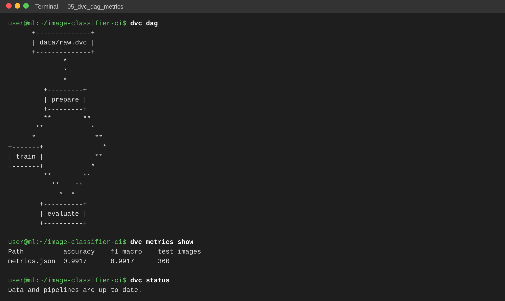

# 4. Step 3: AWS S3 as DVC remote storage

## 4.1 IAM user and AWS CLI

1. In **IAM → Users → Create user**, create `dvc-ci-user` with the policy `AmazonS3FullAccess`
   (in production, a policy limited to the single bucket).
2. Under **Security credentials → Create access key**, choose the CLI use case.
3. Run `aws configure` with that key and region `us-east-1`.

> **[INSERT SCREENSHOT]** `aws configure list` and `aws sts get-caller-identity`

## 4.2 Bucket and DVC remote

```bash
aws s3 mb s3://<bucket-name> --region us-east-1
dvc remote add -d s3remote s3://<bucket-name>/image-classifier
dvc remote modify s3remote region us-east-1
dvc push
```

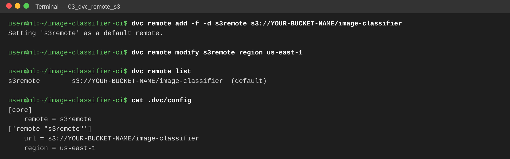

> **[INSERT SCREENSHOT]** `dvc push` output, showing the files uploaded to S3

> **[INSERT SCREENSHOT]** S3 console: bucket → `image-classifier/files/md5/…` objects

DVC stores objects under their MD5 hash, so the object keys in S3 match the hashes in
`dvc.lock` and `data/raw.dvc`. On a new machine, or in CI, `dvc pull` restores the exact
dataset and model for the checked-out commit.

## 4.3 Verification against a local S3 emulator

The S3 workflow was also tested end to end against **moto**, a local server that implements
the S3 API, before AWS credentials were available. The `aws` and `dvc` commands are the same
as for real S3, except for the `--endpoint-url` / `endpointurl` setting. Every screenshot in
this subsection is labeled *LOCAL S3 EMULATOR (moto), not real AWS*.

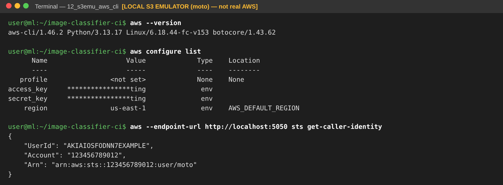


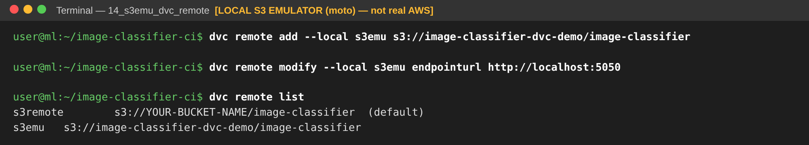


The restore test confirms that the S3 remote holds everything needed to rebuild the
project state. After deleting `data/raw`, `data/processed`, the model and the DVC cache,
`dvc pull` fetched all 1,802 files and `dvc status` reported the workspace up to date.

# 5. Step 4: Automated tests (`test.py`)

`test.py` contains 12 pytest tests:

| Area | What is verified |
|------------|------------------------------------------------|
| Data | split shapes, all 10 classes present |
| Model | test accuracy ≥ 0.95, model file is written |
| Preprocessing | any image → 1×64 vector in [0, 16]; light backgrounds are inverted |
| Prediction | ≥ 45 of 50 real digit images correct; output format |
| API | `/` renders, `/health` returns 200, `/predict` returns the correct label, 400 on missing or invalid upload |

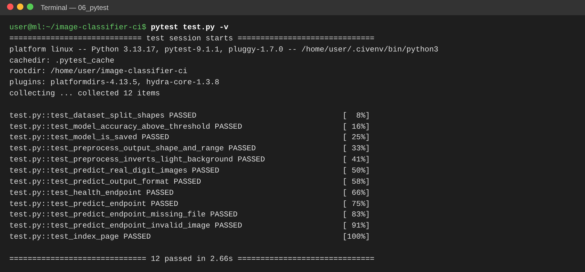

# 6. Step 5: Docker

```dockerfile
FROM python:3.12-slim
WORKDIR /app
COPY requirements.txt .
RUN pip install --no-cache-dir -r requirements.txt   # (+ optional proxy-CA secret mount)
COPY model.py app.py ./
COPY templates/ templates/
COPY models/digit_classifier.joblib models/          # DVC-tracked model
ARG MODEL_VERSION=dev
ENV MODEL_VERSION=${MODEL_VERSION}
RUN useradd --create-home appuser
USER appuser
EXPOSE 5000
HEALTHCHECK CMD python -c "import urllib.request; urllib.request.urlopen('http://localhost:5000/health')"
CMD ["sh", "-c", "gunicorn --bind 0.0.0.0:${PORT} --workers 2 app:app"]
```

Design choices:

- A **slim base image** and only the runtime requirements. DVC and pytest stay out of the image.
- The container runs as a **non-root user**.
- The **model is copied in at build time** from the DVC output, so every image tag maps
  to exactly one model version. The Git SHA is passed in as `MODEL_VERSION` and shown in
  the UI footer.
- `.dockerignore` excludes the raw dataset, `.git` and the DVC cache.

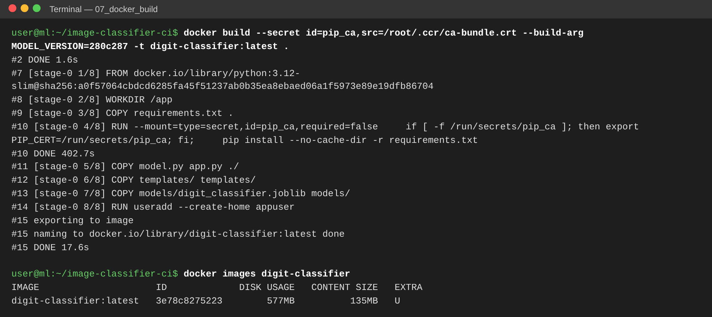

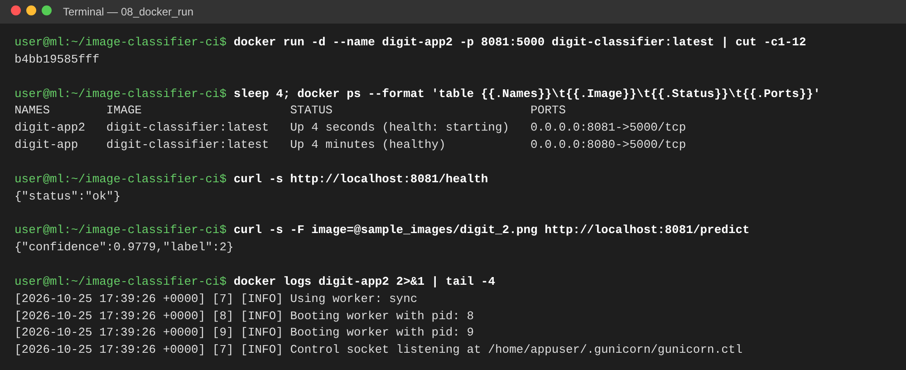

# 7. Step 6: GitHub Actions CI/CD (`ci-cd.yaml`)

The workflow runs on every push and pull request to `main`/`master`, and can also be started
by hand (`workflow_dispatch`). It has three jobs:

**1. `test` (CI)**

- Checks out the code, sets up Python 3.12 and installs `requirements-dev.txt`.
- If `AWS_ACCESS_KEY_ID` is configured, it logs in to AWS and runs **`dvc pull`** from S3.
  Otherwise it regenerates the dataset.
- Runs **`dvc repro`** and `dvc metrics show`, then **`pytest test.py`**.
- Uploads the trained model and the test results (JUnit XML, `metrics.json`) as artifacts.

**2. `build` (CD, not run for pull requests)**

- Downloads the model artifact and builds the Docker image, tagged `latest` and with the commit SHA.
- **Smoke-tests** the image: starts the container, waits for `/health`, sends a real prediction.
- Pushes the image to **GitHub Container Registry**: `ghcr.io/sidhantn12/image-classifier-ci`.

**3. `deploy` (CD, runs once the `EC2_HOST` variable is set)**

- SSHes into EC2 (`appleboy/ssh-action`), logs in to GHCR with the job token, pulls the new
  image, replaces the running container (`--restart unless-stopped -p 80:5000`) and prunes
  old images.
- Verifies the deployment by polling `http://<EC2_HOST>/health` from the runner.

Required repository settings:

| Type | Name | Purpose |
|--------|----------------------------|------------------------------|
| Secret | `AWS_ACCESS_KEY_ID`, `AWS_SECRET_ACCESS_KEY` | `dvc pull` from S3 |
| Secret | `EC2_SSH_KEY` | private key of the EC2 key pair |
| Variable | `EC2_HOST` | public IP of the instance (enables the deploy job) |
| Variable | `EC2_USER` | `ubuntu` |

**Run #1** of the workflow (commit `7a7988b`) completed successfully. The `test` and `build`
jobs passed and the image was pushed to GHCR. The `deploy` job was skipped because
`EC2_HOST` was not yet configured.

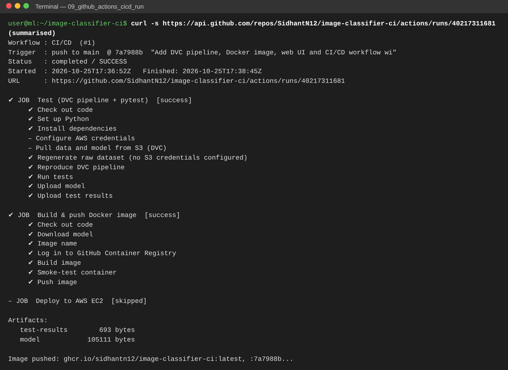

> **[INSERT SCREENSHOT]** GitHub → Actions → CI/CD run: workflow graph with all three jobs green

> **[INSERT SCREENSHOT]** Expanded “Run tests” step showing `12 passed`

> **[INSERT SCREENSHOT]** “Deploy to AWS EC2” job log

# 8. Step 7: AWS EC2 deployment

## 8.1 Launch the instance

1. **EC2 → Launch instance**: *Ubuntu Server 24.04 LTS*, `t2.micro` or `t3.micro` (free tier).
2. **Key pair**: create `image-classifier-key` (.pem). Its content goes in the GitHub secret `EC2_SSH_KEY`.
3. **Security group** inbound rules: SSH (22) from *My IP*; HTTP (80) from `0.0.0.0/0`.
4. **Advanced details → User data**: the contents of `deploy/ec2-user-data.sh`, which
   installs and enables Docker and adds `ubuntu` to the `docker` group.
5. Launch the instance and copy its **Public IPv4 address** into the GitHub variable `EC2_HOST`.

> **[INSERT SCREENSHOT]** EC2 instance list: instance *Running*, public IPv4 visible

> **[INSERT SCREENSHOT]** Security group inbound rules (22, 80)

## 8.2 Deploy

Re-run the workflow (**Actions → CI/CD → Run workflow**) or push a commit. The `deploy`
job then pulls the image on the instance and starts it. To deploy by hand instead:

```bash
ssh -i image-classifier-key.pem ubuntu@<EC2-IP>
./deploy-manual.sh ghcr.io/sidhantn12/image-classifier-ci:latest
docker ps
```

> **[INSERT SCREENSHOT]** SSH session on EC2: `docker ps` showing `digit-classifier` on `0.0.0.0:80->5000/tcp`

# 9. Step 8: Verification and application execution

From any machine, the application is reachable on the instance's public IP:

```bash
curl http://<EC2-IP>/health                                   # {"status":"ok"}
curl -F image=@sample_images/digit_2.png http://<EC2-IP>/predict  # {"confidence":0.98,"label":2}
```

The screenshots below show the same Docker image running and classifying a hand-drawn
digit and an uploaded image:

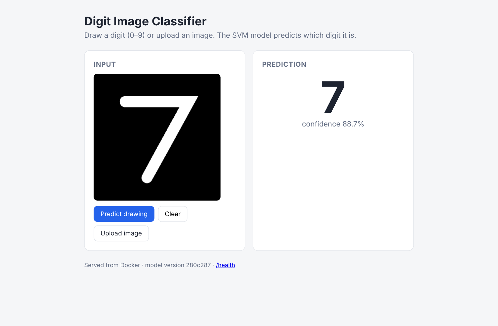

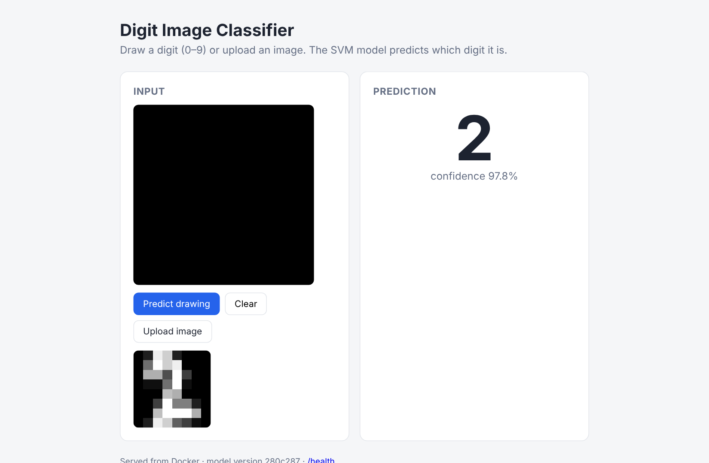

> **[INSERT SCREENSHOT]** Browser at `http://<EC2-public-IP>/` showing a prediction

> **[INSERT SCREENSHOT]** `curl http://<EC2-public-IP>/health` from your machine

**Public application URL:** `http://<EC2-public-IP>/`

# 10. Challenges and solutions

| Challenge | Solution |
|----------------------------------|--------------------------------------------------|
| **The trained model must reach the Docker image without committing binaries to Git.** | The model is a DVC output. In CI it is produced by `dvc repro` (or pulled from S3), uploaded as an artifact by the `test` job and downloaded by the `build` job before `docker build`. |
| **CI must not fail before AWS is set up.** Without S3 credentials, `dvc pull` would fail. | The workflow checks `secrets.AWS_ACCESS_KEY_ID`. With no key, it regenerates the dataset and reproduces the pipeline. The deploy job runs only when `vars.EC2_HOST` is set. |
| **GHCR rejects image names with upper-case letters**, and the GitHub username is `SidhantN12`. | The image name is lower-cased in the workflow: `ghcr.io/${GITHUB_REPOSITORY,,}`. |
| **The EC2 instance cannot pull a private GHCR image.** | The deploy step pipes the job's `GITHUB_TOKEN` into `docker login ghcr.io` on the instance, pulls, then logs out. No long-lived registry credential is stored on the server. |
| **`pip install` failed inside `docker build` with `CERTIFICATE_VERIFY_FAILED`** in the development environment, which sits behind a TLS-inspecting proxy. | An optional BuildKit secret (`--secret id=pip_ca,...`) supplies the proxy CA during the build only. It is not stored in the image, and normal builds (GitHub Actions, EC2) skip it. |
| **The scikit-learn 1.9 deprecation of `SVC(probability=True)`** (scheduled for removal in 1.11) would eventually break CI. | Switched to `CalibratedClassifierCV(SVC(...), ensemble=False)`, the recommended replacement. |
| **User drawings do not look like the training data**: dark ink on a light background, any size. | `preprocess()` inverts light-background images and resizes to 8×8. Tests cover both cases. |
| **S3 had to be tested before AWS credentials were available.** | Ran the `aws s3` and `dvc push`/`pull` commands against moto, a local S3-compatible emulator (Section 4.3). Only the endpoint setting differs, so the same commands work on real S3. |
| **Deployment must be verifiable automatically.** | A Docker `HEALTHCHECK`, a CI smoke test that sends a real prediction, and a post-deploy `curl /health` against the public IP. |

# 11. Conclusion

The project implements a reproducible path from data to deployment:

- DVC versions the 1,797-image dataset and the model and stores them in S3. Every commit pins exact data and model hashes.
- GitHub Actions reproduces the pipeline, runs 12 tests, then builds, smoke-tests and publishes a Docker image.
- The image runs on AWS EC2 and is reachable on the instance's public IP.

A push to `main` carries a change through testing to production without manual steps.

# 12. Links

- **GitHub repository:** <https://github.com/SidhantN12/image-classifier-ci>
- **CI/CD run #1:** <https://github.com/SidhantN12/image-classifier-ci/actions/runs/40217311681>
- **Docker image:** `ghcr.io/sidhantn12/image-classifier-ci:latest`
- **Deployed application:** `http://<EC2-public-IP>/`
